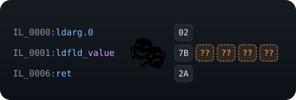

<p align="center">
  
</p>

# ILMask

IDA-style masks for .NET IL code. A mask is a byte pattern where `??` matches any byte:

```
02 7B ?? ?? ?? ?? 2A      ldarg.0; ldfld <any field>; ret
```

You can **write** masks (by hand, from a method body, or from ILSpy / dnSpy / ildasm text),
**read** them back from text, and **find** them in IL to pull out the bytes under the wildcards.

## Requirements

.NET 10 SDK.

## Install

Download `ILMask.<version>.nupkg` from the [Releases](https://github.com/Neotoxic-off/ILMask/releases)
into a folder, then add it to your project:

```bash
dotnet add package ILMask --source ./path/to/that/folder
```

Each release also has `ILMask.dll` (with `ILMask.xml` for IntelliSense) if you prefer a plain reference.

## Release

The CI (`.github/workflows/ci.yml`) lints, tests and packs every push and pull request; the package is
attached to each run. Pushing a `v` tag publishes a GitHub release with that version:

```bash
git tag v1.0.0
git push origin v1.0.0
```

## No exceptions

Every factory follows the `Try` pattern and never throws, even on `null`:

```csharp
IlMask? mask = null;
string? error = null;

if (!IlMask.TryParse("02 7B ?? ?? ?? ?? 2A", out mask, out error))
{
    Console.WriteLine(error);   // e.g. "Invalid mask byte 'GG' at position 1: expected two hex digits, '?' or '??'."
}
```

Each `Try...` method has two overloads: `(input, out mask)` and `(input, out mask, out error)`.

## Usage

### Read a mask

```csharp
IlMask? mask = null;

IlMask.TryParse("02 7B ?? ?? ?? ?? 2A", out mask);
```

Tokens are separated by whitespace. Each one is a two-digit hex byte (`7B`, `7b`) or a wildcard (`??` or `?`).

### Write a mask

```csharp
byte[] il = typeof(Foo).GetMethod("Bar")!.GetMethodBody()!.GetILAsByteArray()!;
IlMask? fromCode = null;
IlMask? fromIl = null;

// From code: null is a wildcard.
IlMask.TryCreate([0x02, 0x7B, null, null, null, null, 0x2A], out fromCode);

// From a compiled method: metadata tokens (fields, methods, types, strings, signatures)
// are wildcarded, because they change from one build to another. Everything else is exact.
IlMask.TryFromIl(il, out fromIl);

// To text, readable again by IlMask.TryParse.
Console.WriteLine(fromIl!.ToString());   // "02 7B ?? ?? ?? ?? 2A"
```

### Write a mask from ILSpy, dnSpy or ildasm

Copy the IL of a method (or just a few instructions) from your decompiler and paste it:

```csharp
const string listing = """
    .method public hidebysig instance int32 Get (int32 index) cil managed
    {
        .locals init ([0] int32 result)

        IL_0000: ldarg.s index
        IL_0002: ldc.i4.s 42
        IL_0004: stloc.s result
        IL_0006: ldfld int32 Foo::_value
        IL_000b: br.s IL_0000
    }
    """;
IlMask? mask = null;

IlMask.TryFromListing(listing, out mask);
Console.WriteLine(mask!.ToString());   // "0E 01 1F 2A 13 00 7B ?? ?? ?? ?? 2B F3"
```

The result is the same mask as `TryFromIl` on the compiled method: the integration tests check this
on every method of `string`, `List<T>`, `Dictionary<TKey,TValue>`, `Enumerable` and `Math`,
disassembled by the real ILSpy engine.

- **Instructions**: every line that starts with an `IL_xxxx:` label, as all three tools print it.
  dnSpy's `/* 0x... */` byte comments and ildasm's `/bytes` comments are understood. A label inside
  a string (`ldstr "IL_0001:"`) is not an instruction.
- **Ignored text**: method headers, `.maxstack`, `.try` / `catch` blocks, braces, comments.
- **Exact operands**:
  - constants: decimal or hex (`ldc.i4 0x3e8`), floats (`1E-300`), and raw bytes for NaN and
    infinities (`ldc.r4 (00 00 C0 FF)`);
  - branch and `switch` targets, computed from the `IL_xxxx` labels;
  - arguments and locals, by number (`ldloc.s 4`), generated name (`V_4`, `A_4`) or declared name
    (`ldarg.s index`, read from the `.method` header and `.locals` of each pasted method,
    `instance` methods counting `this` as argument 0).
- **Wildcards**: metadata tokens, whose values the text does not show, and argument or local names
  that the pasted text does not declare.

### Find a mask and extract its content

```csharp
foreach (IlMaskMatch match in mask.Find(il))
{
    int offset = match.Offset;                       // where the match starts
    ReadOnlyMemory<byte> bytes = match.Bytes;        // every matched byte
    ReadOnlyMemory<byte> content = match.Wildcards;  // only the bytes under the ?? wildcards
}
```

| Method      | Matches start                      | Use it on                    |
|-------------|------------------------------------|------------------------------|
| `Find`      | on an instruction                  | a method body                |
| `FindBytes` | at any byte offset (overlapping)   | a whole file or section      |

Both are lazy and return matches in offset order; `Find(il).FirstOrDefault()` stops at the first one.
`Find` skips, one byte at a time, any bytes that do not decode as an instruction.

Wildcards over a metadata token give you the token, which you can resolve back:

```csharp
IlMask? ldstr = null;

IlMask.TryParse("72 ?? ?? ?? ??", out ldstr);
foreach (IlMaskMatch match in ldstr!.Find(il))
{
    int token = BinaryPrimitives.ReadInt32LittleEndian(match.Wildcards.Span);

    Console.WriteLine(method.Module.ResolveString(token));
}
```

## Development

```bash
dotnet build                          # analyzers run as errors (latest-recommended + .editorconfig)
dotnet format --verify-no-changes     # linter
dotnet test                           # unit + integration tests
```

- `tests/ILMask.Tests`: unit tests. `dotnet test` fails if line, branch or method coverage of
  the library drops below 100%.
- `tests/ILMask.IntegrationTests`: runs masks against IL compiled by the C# compiler, against
  methods of the BCL, and against listings produced by ILSpy's disassembler (`ICSharpCode.Decompiler`).

### Code style

- Explicit types everywhere, never `var` (enforced by the linter).
- No `throw` and no `try`/`catch`: failures are `Try...` methods returning `false` and an error.
- In every function, local variables are declared and initialized first, then a blank line,
  then the code.
